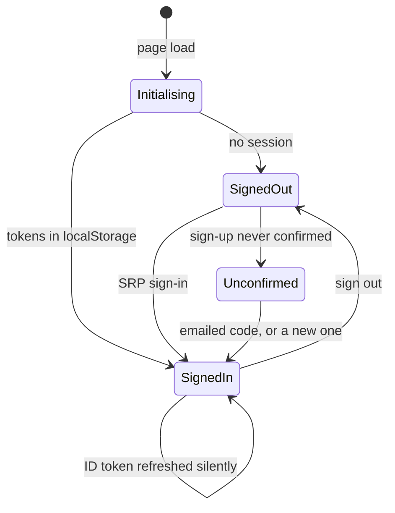
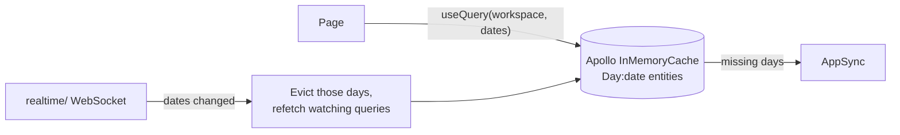

# How the web app is built

The inside of mootmaker-webapp: code layout, routes, sign-in, data and caching, the rules every page
follows, and hosting. The product rules it implements are in the hub's
[use cases](https://github.com/geoffweatherall/mootmaker/blob/main/docs/reference/use-cases.md).

## Stack

React 19 and TypeScript, built by Vite, no server-side rendering. MUI 9 (with MUI X date pickers and
dayjs) for components, themed from the hub's [brand tokens](https://github.com/geoffweatherall/mootmaker/tree/main/docs/showcase/branding).
Apollo Client 4 for GraphQL, `amazon-cognito-identity-js` for sign-in, React Router 7 for routing.
oxlint, Vitest and Playwright for checks and tests.

## Code layout (`webapp/src/`)

| Path | Holds |
|---|---|
| `App.tsx` | The routes |
| `main.tsx` | Start-up: fonts, theme, Apollo and auth providers, the live-update subscription |
| `config.ts` | Runtime configuration, read from `window.__MOOTMAKER_CONFIG__` (see below) |
| `apolloClient.ts`, `cachePolicies.ts` | The one Apollo client and the cache's type policies. Each policy's comment says why it exists |
| `auth/` | `cognito.ts` (the only module that talks to Cognito), `AuthProvider.tsx` and `authContext.ts` (the `useAuth()` hook). `cognito.mock.ts` replaces `cognito.ts` in mock mode |
| `graphql/` | Operations (`queries.ts`, `mutations.ts`), `generated/` (from the schema; never edit), the error-code wording (`validationMessages.ts`), date and time formatting (`formatDateTime.ts`), cache helpers |
| `realtime/` | The AppSync WebSocket client and the rules for evicting and refetching days |
| `pages/` | One component per route, with page logic extracted into `*Logic.ts` files so it can be unit tested |
| `components/` | Shared components: layout and navigation, route guards, meeting detail, banners, avatars |
| `theme/` | The MUI theme, room colours, the light/dark switch, the week-start locale |
| `testSupport/mocks/` | The MSW handlers and fixtures behind mock mode |

## Routes

| Route | Page | Access |
|---|---|---|
| `/` | Home: the demo login and sign-up steps when signed out; your agenda when signed in | Public |
| `/signin`, `/signup`, `/forgot-password`, `/about` | Account pages and About | Public |
| `/rooms/:date/availability` | Room availability for a day | Signed in |
| `/persons/:personId/calendar` | One person's working week, Monday to Friday | Signed in |
| `/meetings/add`, `/meetings/:meetingId/edit` | The meeting form, for creating and editing | Signed in |
| `/meetings/:meetingId` | A meeting on its own page, for shared links | Signed in |
| `/settings` | Your name, date and time formats, delete account | Signed in |
| `/rooms`, `/persons` | Room and person administration | Admin |

`RequireAuth` sends a signed-out visitor to `/signin` and back afterwards. `RequireAdmin` sends a
non-admin home. Both are courtesies: every rule is enforced by the API.

## Configuration at run time

The build contains no environment's addresses. `index.html` loads `/env-config.js`, which sets
`window.__MOOTMAKER_CONFIG__` (GraphQL URL, user pool, app client, demo login) before the app starts.
`deploy.sh` writes that file from SSM after the build; locally, `npm run dev` and `dev:mock` generate it
from `.env` or `.env.mock`. So one build can be deployed to any environment unchanged.

## Signing in

- `amazon-cognito-identity-js` signs in with SRP and keeps the tokens in `localStorage`, refreshing the ID
  token as it expires. Apollo's `SetContextLink` attaches it to every request.
- **"Initialising" is a real third state.** Until the first session check resolves, pages show a spinner
  rather than guessing signed-out, so a signed-in visitor never sees the signed-out home page flash past.
- `useAuth()` exposes the email, `isAdmin` (from the token's `custom:class`), the caller's Person (read
  live as `workspace { me }`, so a rename shows at once) and their display preferences.
- **An account whose sign-up was never confirmed is not a dead end.** When Cognito refuses sign-in with
  `UserNotConfirmedException`, the sign-in form asks for the emailed code, offers **Send a new code**,
  then signs in with the password already typed. The sign-up page's code step can resend too.
- An account with no linked Person sees an explanation on Home instead of an agenda, and Calendar is
  disabled.

## Data, caching and live updates

- **Every screen reads through `workspace(dates: [...])`**, naming the dates it shows. Days are cached
  entities keyed by date (`Day:2026-10-14`), so a day fetched by one page serves every other.
- **Reference data** (rooms, people, the caller) is read `cache-first` and refetched on reconnect or
  return to the tab; **days** are `cache-and-network`, so cached ones show at once and refresh in the
  background.
- **Mutations return the new state** (`createMeeting` returns the whole day), and the cache absorbs it.
  A mutation that returns a new room or person also writes it into the cached lists
  (`referenceDataCache.ts`), since Apollo cannot know those are the same list.
- **Live updates** evict changed days and refetch only the queries watching them. A reconnect or a
  return to the tab evicts everything. A tab ignores broadcasts for a date it wrote itself for 5 seconds,
  and a response that was in flight when its date changed is fetched again (`reconcileLink.ts`).
  The full rules, and how the Android app does the same, are in the hub's
  [concurrent updates overview](https://github.com/geoffweatherall/mootmaker/blob/main/docs/overview/concurrent-updates.md).
- **While a day refetches, the last-known meetings stay on screen** (`keepDaysWhileRefreshing.ts`) under
  a progress bar.
- **The booking window comes from the server** (`boundaries.ts`), never computed here.

## Rules every page follows

**Loading and empty states.**
- First load, with nothing cached: a centred spinner.
- Refreshing, with data on screen: keep the data, show a thin progress bar above it.
- **Never show an empty state ("No meetings today") while a refetch is in flight.** A cached zero is not
  known to be true until the refetch settles.

**Errors.** Two kinds, both shown in the dismissible `ErrorBanner` at the top of the page:
- Network and GraphQL errors, flattened to text by `errorMessages.ts`.
- Validation results: the API's `errors` codes, each mapped to wording in `validationMessages.ts`. That
  map is typed by the generated enums, so a new code does not compile until it has a message.

**Validation.** The API enforces every rule. The UI only prevents what it can cheaply: time pickers offer
quarter hours only, people and rooms are picked from lists, the organiser cannot be picked as an
attendee and the other way round. Everything else is shown when the API refuses.

**Saving.** `SubmitButton` disables itself with a spinner while a mutation is in flight. After a save,
the form returns to the page it was opened from (`useReturnHereState`) with a success toast.

**Dates and times.** Times from the API are zone-less local times; `formatDateTime.ts` splits the string
rather than parsing a `Date`, so the browser's time zone can never shift them. Each viewer's own date and
time format applies everywhere, including when viewing someone else's meeting. A meeting's date is shown
once, with a time range beside it. Week start applies to date-picker grids only. Rules for the whole
system: [time and time zones](https://github.com/geoffweatherall/mootmaker/blob/main/docs/overview/time-and-time-zones.md).

**Locating elements.** Tests find elements by role and accessible name, the same labels a screen reader
uses, so pages must give every control one.

## Meetings

- **One meeting-detail component.** `MeetingDetailContent` renders a meeting everywhere: the bottom sheet
  on narrow screens, the side panel on wide ones (both via `useMeetingDetailOverlay`), and the
  `/meetings/:id` page. Change it there, never in a page.
- **`/meetings/:id` is a deep link only.** Nothing in the app navigates there; the Share action (native
  share sheet, or copy to clipboard) hands it out. Its Back button shows only when the page was reached
  from inside the app.
- **An open meeting stays live.** It binds to the cache with `useFragment`. When its day is evicted it
  keeps showing the last-known meeting and asks the API for that one meeting; only a `null` answer shows
  "This meeting was cancelled".
- **Edit and cancel** are shown to the organiser and admins only (the API enforces the same). Editing
  reuses the add-meeting form at `/meetings/:id/edit`, fetches the meeting fresh, and sends its version so
  a stale save is refused with `MeetingChanged`. Cancelling asks for confirmation and deletes the meeting.
- **Responses.** An attendee's own row in a meeting has a Going / Maybe / Not going control; everyone
  else's shows a badge whose colour and shape both carry the state. Home's "Needs your response" has the
  same buttons.
- **Suggest a room** asks the API once per combination of time and attendee count, then steps through the
  cached ranked list on each press; when editing, the meeting's current room comes first.

## Look and feel

The theme (`theme/`) builds MUI's palette, typography (Inter for text, Outfit for headings, self-hosted),
shadows and component styles from the brand tokens, and follows the operating system's light or dark
setting. Rooms get one of eight colour-blind-safe colours: the admin's choice, or one by position in the
sorted room list. Colour is never the only identifier; a room's name is always shown with it. Navigation
is a permanent sidebar on wide screens and a drawer on narrow ones.

## Hosting

The built files are uploaded to a private S3 bucket that only CloudFront can read (origin access
control). CloudFront redirects HTTP to HTTPS, serves `index.html` for unknown paths so client-side routes
work, and is invalidated (`/*`) on every deploy. Each environment has its own certificate and DNS record
for `www.<env>.mootmaker.com`. There are no security response headers yet
([mootmaker-webapp#170](https://github.com/geoffweatherall/mootmaker-webapp/issues/170)).
